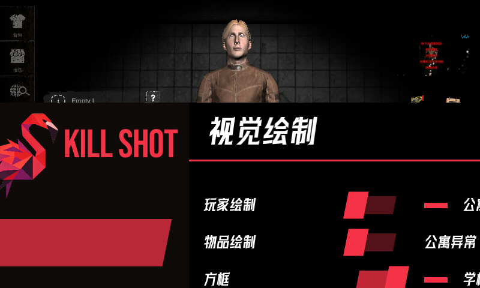

# 04 · 部署与真机验证

## 4.1 路线选择

`libTool.so` 是**被 `System.loadLibrary("Tool")` 加载**的，而这句话只存在于 kill shot 版的 `classes.dex` 里。
官方版 APK 没有这个入口，所以：

| 对方装的是 | 需要替换的入口 | 部署的三个文件 |
|---|---|---|
| 官方版 APK | `libmain.so`（Unity 必加载） | `libmain.so`(loader) + `libmain_orig.so`(原版备份) + `libToolShell.so` |
| kill shot 版 APK | `libTool.so`（dex 已经会加载） | `libTool.so`(loader) + `libToolShell.so` |

两者都用同一个 `libToolShell.so`（patch 后的加固壳），区别只在"谁把壳拉起来"。

> ⚠️ 两种模式**只选一个**。两个 loader 同时生效会让壳的 `JNI_OnLoad` 跑两次。

## 4.2 loader 原理

两个 loader 结构完全同构（[`loader/loader.c`](../loader/loader.c)、
[`loader/loader_main.c`](../loader/loader_main.c)）：

```
① dladdr(JNI_OnLoad) 取自己路径 → 替换文件名
② dlopen(目标原库)  → dlsym("JNI_OnLoad") → 原样调用（转发）
③ dlopen("libToolShell.so") → dlsym("JNI_OnLoad") → 调用（壳去解密 payload）
④ dl_iterate_phdr 找 dlpi_name 含 "memfd" 的模块 → 取 base
⑤ mprotect → 把 base+0x51D49C 写成 b（内层卡密恒成功）
⑥ return 原库的返回值（Unity 要 0x10006）
```

- `libmain` 版：第 ② 步转发给 `libmain_orig.so`（原版 Unity libmain，6,728 B）
- `libTool` 版：第 ② 步没有转发对象，直接进第 ③ 步

编译（NDK r27c）：

```bash
cd loader && make NDK=$ANDROID_NDK_HOME
# 产物 prebuilt/libmain.so (8,432 B) / prebuilt/libTool.so (8,384 B)
```

两个 so 的导出都只有 `JNI_OnLoad`，`NEEDED` 只有 `libdl` `liblog` `libc`，没有任何第三方依赖。

## 4.3 部署

有 root（Magisk / KernelSU / APatch）：

```bash
# 手机端零电脑
# 1. 把 killshot.zip 解压到 /sdcard/killshot/
su -c "sh /sdcard/killshot/install.sh"

# 或者用 adb
adb push killshot /data/local/tmp/
adb shell su -c "sh /data/local/tmp/killshot/deploy.sh"
```

`deploy.sh` 会：

1. `pm path com.Gameplier.TheGhost` 拿到 `/data/app/…/base.apk` → 推出 `lib/arm64` 目录
2. **自动识别版本**：`lib/arm64/libTool.so` 存在且 > 1 MB → kill shot 版；否则官方版
3. 备份原文件（`libmain_orig.so` / `libTool.so.orig`）
4. 放入 loader 与 patch 壳
5. `chown system:system`（可能被拒，跳过即可）+ `chmod 755` + `chcon u:object_r:apk_data_file:s0`
6. 全部幂等，可重复执行

还原：`su -c "sh …/deploy.sh restore"`

**为什么必须 root**：`/data/app/…/lib/` 归 `system:system`，SELinux 上下文 `apk_data_file`，
只有 root 能写。没有 root 只能重打包 APK（必须重签名 → 必须卸载原版 → 存档风险）。

## 4.4 真机验证

设备：三星 SM-G9866 / Android 10 / arm64-v8a / Magisk

### official 模式（纯重启，没有任何调试工具介入）

```
I MainLoader: forwarding to .../lib/arm64/libmain_orig.so
I MainLoader: libmain_orig JNI_OnLoad -> 0x10006
I MainLoader: loading shell: .../lib/arm64/libToolShell.so
I MainLoader: shell JNI_OnLoad -> 0x10006
I MainLoader: payload module: /memfd:ef54c08bf6a4f66ee4a22dab31ec1d9b (deleted) base=0x722fc04000
I MainLoader: patched 0x723012149c: 0x540001a1 -> 0x1400016f
```

进程稳定，游戏主界面正常，**KILL SHOT 面板直接展开，没有身份验证页**。



### killshot 模式

```
I ToolLoader: loader constructed
I ToolLoader: loading real shell: .../lib/arm64/libToolShell.so
I ToolLoader: shell JNI_OnLoad -> 0x10006
I ToolLoader: payload module: /memfd:70e29e6c44f55587f9bc3d3eb6944df3 (deleted) base=0x709ac80000
I ToolLoader: patched 0x709b19d49c: 0x540001a1 -> 0x1400016f
```

（该模式下还额外验证过：不改任何东西、直接在 UI 输入任意卡密 `TEST123456` 也能进菜单。）

## 4.5 完整补丁表

| # | 目标 | 偏移 | 原值 | 改后 | 作用 |
|---|---|---|---|---|---|
| 1 | 加固壳（文件） | `0x5E30EC` | `c0 01 00 34` cbz | `1f 20 03 d5` nop | 认证失败不自杀 |
| 2 | 加固壳（文件） | `0x5E3114` | `c0 01 00 54` b.eq | `0e 00 00 14` b | 无条件走"通过" |
| 3 | payload（内存） | `0x51D49C` | `a1 01 00 54` b.ne | `6f 01 00 14` b | 卡密永远校验成功 |

1、2 由 [`patches/patch_shell.py`](../patches/patch_shell.py) 一次性完成；
3 由 loader 在每次进程启动时自动完成。

## 4.6 限制

- **只对当前壳版本有效**（md5 `896cc83f7de4e6b4875bd310cf41f530`）。作者换壳后偏移会变，需重新定位。
- payload 的 `0x51D49C` 同理，换版本后要用 `objdump` 重新找 `b.ne 0x51DA58` 那条。
- 卸载 / 更新 APK 会重建 `lib/` 目录，需要重跑部署。
- 32 位设备 / 非 arm64 无效（壳只有 arm64-v8a）。
- 想彻底静默：hosts 里把 `wy.llua.cn` 指到 `127.0.0.1`
  （payload 仍会发请求，patch 只改判定）。
